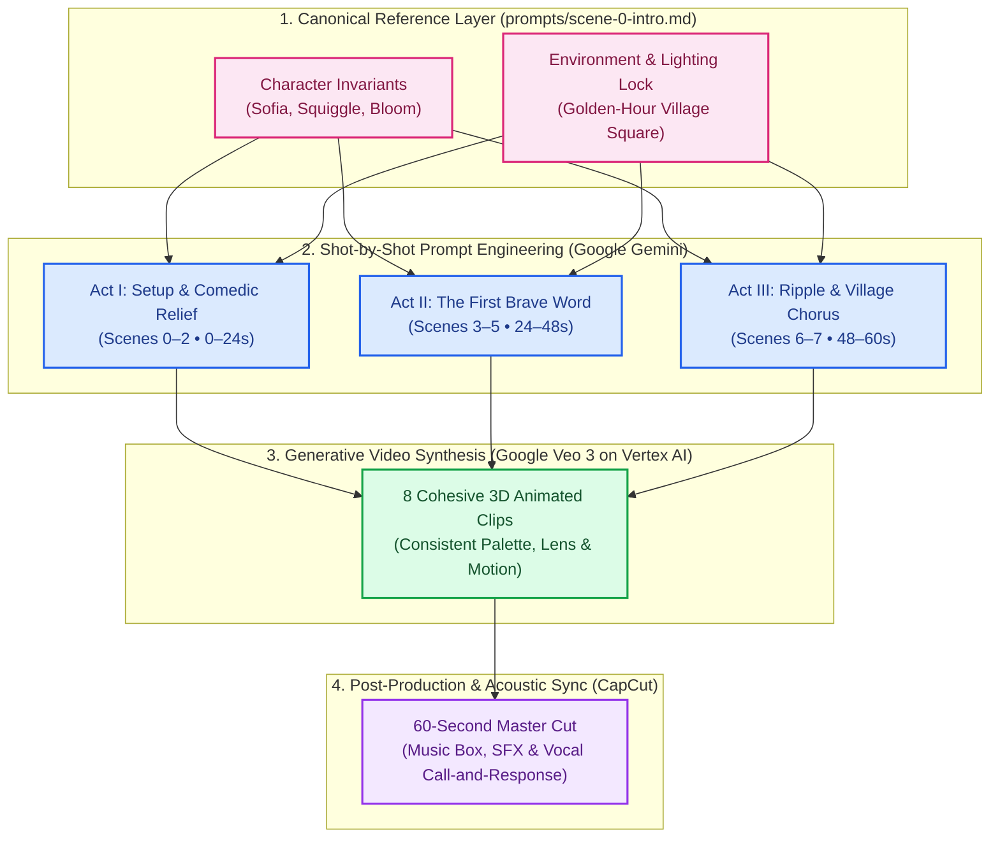

# 🌸 Sofia's Song: Multi-Shot AI Animation with Google Gemini & Veo 3


[](https://github.com/RobinaMirbahar)

> **Author & Architect:** [Robina Mirbahar](https://github.com/RobinaMirbahar) ([Google Developer Expert in Cloud & AI](https://developers.google.com/profile/u/106918534005910641104?utm_campaign=deveco_gdemembers&utm_source=deveco))  
> **Focus:** AI-Directed Cinematic Storytelling, Multi-Shot Prompt Choreography & Audio-Visual Synchronization with Google Veo 3

This repository contains the modular prompt architecture, character-locking specifications, and scene-by-scene cinematography blueprints for **Sofia's Song**—a 1-minute whimsical 3D animated short created with **[Google Gemini](https://ai.google.dev/gemini-api/docs?utm_campaign=deveco_gdemembers&utm_source=deveco)** and **[Google Veo 3 on Vertex AI](https://cloud.google.com/vertex-ai/generative-ai/docs/models/veo/3-0-generate-preview?utm_campaign=deveco_gdemembers&utm_source=deveco)**.

You can watch the completed short film and explore the companion Veo 3 project directly:
* 🎥 **Watch the Short Film (YouTube):** [Sofia's Song — A Whimsical 1-Minute Animated Story](https://www.youtube.com/watch?v=rS-gXC0XoH0)
* 🎬 **Companion Veo 3 Film & Repository:** [Crayon Skies (`crayon-skies-veo3`)](https://github.com/RobinaMirbahar/crayon-skies-veo3) · [Watch Crayon Skies on YouTube](https://www.youtube.com/watch?v=qwILtvTzofc)

---

## 📑 Table of Contents
* [🎬 What is Sofia's Song?](#-what-is-sofias-song)
* [🧚 Canonical Character & Prop Directory](#-canonical-character--prop-directory)
* [📐 Multi-Shot Production Architecture](#-multi-shot-production-architecture)
* [🚀 Repository Structure & Modular Prompt Strategy](#-repository-structure--modular-prompt-strategy)
* [🛠️ Core Scene Architecture & Prompt Modules](#-core-scene-architecture--prompt-modules)
* [📦 Reproduction & Production Workflow](#-reproduction--production-workflow)

---

## 🎬 What is Sofia's Song?

> *“One brave hum. Two magical friends. A village that listened.”*

**Sofia's Song** is a 60-second Pixar-inspired (*Luca* / *Turning Red* aesthetic) animated story about overcoming the fear of judgment and finding your voice. Rather than relying on a single monolithic video prompt, the film is engineered as a **Multi-Shot Cinematography Pipeline** across eight 8-second scene modules that collaborate to:

* **Lock Character & World Identity Across Cuts:** Enforce strict visual invariants (wardrobe embroidery, hair physics, companion proportions, and golden-hour cobblestone lighting) across all eight shots so characters never morph between scenes.
* **Choreograph Camera & Acoustic Pacing:** Pair explicit camera trajectories (*low-angle glides, slow push-ins, 360° crane pull-ups*) with diegetic sound cues (*hand-cranked wooden music box, tin-bucket percussion, call-and-response vocals*).
* **Progressively Escalate Emotional Beats:** Transition protagonist *Sofia* from hiding behind a bush (`Scene 0`) → comedic tension release (`Scenes 1–2`) → a single whispered word (`Scene 4`) → a village-wide musical chorus (`Scene 7`).

---

## 🧚 Canonical Character & Prop Directory

* **`Sofia` (Protagonist):** Expressive young singer with bright eyes, a neatly tied black braid lifted by the breeze, and a flowing traditional pink Asian festival dress embroidered with golden threads. Transitions from timid hesitation to joyful confidence.
* **`Squiggle` (Comedic Sidekick):** Fluffy, round-cheeked squirrel companion wearing an identical forest-green jumper and fluttering red scarf in every scene; provides physical-comedy relief and high-energy encouragement.
* **`Bloom` (Emotional Guide):** Calm, floating blossom companion dressed in soft lavender petals with a glowing daisy crown; delivers quiet, grounding wisdom (*"Sing it truthfully"*).
* **`The Banana Mic & Crank Music Box` (Narrative Props):** A playful banana passed around as a pretend microphone alongside a wooden hand-cranked music box and swaying paper lanterns that anchor the village square setting.

---

## 📐 Multi-Shot Production Architecture

> **🆕 Pipeline Highlight:** Separates **Static Visual Invariants** (`Scene 0` Reference Sheet) from **Per-Shot Motion & Camera Vectors** (`Scenes 1–7`), feeding structured Gemini shot specifications into Google Veo 3 (`8s` clips) before final timeline assembly.  
> *(🩷 Pink = Canonical Reference Anchor | 💙 Blue = Gemini Prompt Synthesis | 💚 Green = Veo 3 Multi-Shot Rendering | 💜 Purple = NLE Audio-Visual Master)*



---

## 🚀 Repository Structure & Modular Prompt Strategy

To keep the prompt engineering clean, reproducible, and free of context bleed, each 8-second beat of the film is isolated in its own dedicated Markdown specification under [`prompts/`](prompts/):

```text
A-Gemini-Veo-3-Whimsical-Short/
├── README.md                         # Architecture documentation & production guide
├── LICENSE                           # MIT Open-Source License
└── prompts/                          # Modular scene-by-scene Veo 3 & Gemini specifications
    ├── scene-0-intro.md              # Canonical Character/Environment Bible + Scene 0 (0–8s)
    ├── scene-1-distraction.md        # Scene 1: Squiggle's Fruit-Cart Distraction (8–16s)
    ├── scene-2-slip.md               # Scene 2: The Slow-Motion Petal Slip (16–24s)
    ├── scene-3-first-note.md         # Scene 3: Low-Angle Glide & Bloom's Counsel (24–32s)
    ├── scene-4-hi.md                 # Scene 4: Article Four & The First "Hi" (32–40s)
    ├── scene-5-step-light.md         # Scene 5: Stepping into the Lantern Light (40–48s)
    ├── scene-6-ripple.md             # Scene 6: The Seated Circle & Melodic Ripple (48–56s)
    └── scene-7-chorus.md             # Scene 7: Call-and-Response Finale & Crane Pull-Up (56–60s)
```

### Why Modular Per-Scene Prompt Files Instead of One Monolithic Script?
* **Zero Cross-Shot Action Bleed:** Generative video models hallucinate when given multi-minute scripts at once. Isolating each 8-second window (`scene-0` through `scene-7`) bounds the temporal action to a single camera movement and emotional beat.
* **Self-Contained Character Re-Injection:** Because video generation is stateless across separate API calls, each `.md` module explicitly re-states Sofia's, Squiggle's, and Bloom's canonical visual descriptors alongside the new scene action.
* **Targeted Shot Re-Rolls:** If a single clip needs a camera or lighting adjustment (e.g., tweaking the slow-motion fall in `scene-2-slip.md`), you can re-prompt and re-render that isolated module without touching the rest of the timeline.

---

## 🛠️ Core Scene Architecture & Prompt Modules

| Scene & Window | Prompt Module | Cinematography, Camera & Veo 3 Mechanics Implemented |
| :--- | :--- | :--- |
| **#0: Character Bible & Intro**<br>`00:00 – 00:08` | [`prompts/scene-0-intro.md`](prompts/scene-0-intro.md) | Establishes the global **Character & Environment Reference Sheet** (3D Pixar *Luca*/*Turning Red* style, golden-hour village square, stone fountain, crank music box, zero style-drift rules):<br>• **Camera Trajectory:** Smooth glide across the sunlit square brushing past the rippling fountain, fruit cart, and wooden echo cone before pushing in on a tall bush.<br>• **Character Staging:** Sofia peeks nervously from behind the bush; Squiggle crouches with a twitching tail; Bloom hovers warmly (*"You're ready. You know the words."* / *"…But what if they laugh at me?"*). |
| **#1: The Distraction**<br>`00:08 – 00:16` | [`prompts/scene-1-distraction.md`](prompts/scene-1-distraction.md) | Introduces comedic tension release and the **Banana Mic** prop to soften Sofia's stage fright:<br>• **Action Choreography:** Squiggle darts into the open with his red scarf fluttering like a cape, leaps mid-air to snatch the banana mic, and belts atop the fruit cart (*"Ohhh, I forgot the lyrics but I'm still singing!"*).<br>• **Background Micro-Gags:** A waltzing cat in a top hat and a rolling tomato that lands squarely on a strutting chicken's head.<br>• **Emotional Anchor:** Bloom whispers *"See? You don't have to be perfect to shine"* as accordion and drum cues swell. |
| **#2: The Slip ("Oops!")**<br>`00:16 – 00:24` | [`prompts/scene-2-slip.md`](prompts/scene-2-slip.md) | Transitions Sofia from hidden observer to center-stage participant via slow-motion physical comedy:<br>• **Inciting Beat:** Squiggle pops up wearing an orange-peel crown (*"You're next! It's the rules of the Banana Mic"*); Sofia steps back onto a loose cobblestone.<br>• **Temporal Pacing:** Slow-motion fall—arms flail, black braid arcs through the air, wooden echo cone rolls—before a soft landing in Bloom's scattered flower petals.<br>• **Reframing Fear:** When the square falls silent and the banana mic lands beside her, Squiggle erupts into applause (*"Best entrance ever!"*), turning potential embarrassment into warm invitation. |
| **#3: The First Note**<br>`00:24 – 00:32` | [`prompts/scene-3-first-note.md`](prompts/scene-3-first-note.md) | Low-angle environmental tracking shot leading into an intimate emotional close-up:<br>• **Environment Polish:** Golden-hour rays across fluttering laundry lines, oversized clay-pot sunflowers, spinning pinwheels, soap bubbles, and tinkling wind chimes.<br>• **Camera Glide:** Drifts past a sleepy goat in orange-rind sunglasses and the top-hat cat riding a turtle-shaped skateboard before centering on Sofia seated in the petals.<br>• **Thematic Core:** Bloom pulses with soft lavender light (*"You don't have to sing it perfectly. Just sing it truthfully"*), while Squiggle dangles upside-down from a clothesline. |
| **#4: One Brave Word ("Hi.")**<br>`00:32 – 00:40` | [`prompts/scene-4-hi.md`](prompts/scene-4-hi.md) | Acoustic hush and first vocalization beat that transforms the crowd from spectators into participants:<br>• **Staging & Hush:** Squiggle unrolls an imaginary scroll (*"In accordance with Article Four of the Banana Mic Rules… the stage shall now accept ONE BRAVE WORD!"*) as a boy taps a gentle beat on a tin bucket.<br>• **Vocal Catalyst:** Sofia takes a shaky breath and whispers *"Hi"* into the banana mic; Squiggle spirals into a cart of beanbags (*"SHE SAID HI!"*) as the children echo back *"Hi-hi-hi-hi!"* in rhythm.<br>• **Camera Swirl:** Upward swirling camera as Sofia laughs and sings a louder *"Hiiiii!"* while a goat harmonizes. |
| **#5: Stepping into the Light**<br>`00:40 – 00:48` | [`prompts/scene-5-step-light.md`](prompts/scene-5-step-light.md) | Lighting and posture transformation as Sofia steps fully out from the shadow of the bush:<br>• **Lighting Shift:** Warm lantern light catches the golden embroidery of Sofia's dress as swirling flower petals frame her standing posture.<br>• **Companion Reaction:** Squiggle lands in front of her in a dramatic superhero pose before flopping into a bed of petals; Bloom whispers *"They heard you"* as gentle applause ripples across the square. |
| **#6: The Melodic Ripple**<br>`00:48 – 00:56` | [`prompts/scene-6-ripple.md`](prompts/scene-6-ripple.md) | Wide amber circle composition and slow push-in capturing communal musical contagion:<br>• **Blocking:** Children sit in a loose circle under glowing lanterns with Sofia seated among them, humming an unpolished, heartfelt melody.<br>• **Acoustic Propagation:** Camera pushes in as a braided girl sways, a boy taps a wooden spoon on beat, the trumpet goat bleats in harmony, and a child tosses Sofia a marigold garland (*"I could do that again…"*). |
| **#7: Together Now (Finale)**<br>`00:56 – 01:00` | [`prompts/scene-7-chorus.md`](prompts/scene-7-chorus.md) | Full-village call-and-response celebration culminating in an aerial night-sky crane pull-up:<br>• **Call & Response:** Sofia stands center-circle holding the banana mic with both hands (*"Hi to you…" / "Hi to me!" / "Hi to everything I see!"*), joined by a grandma on tambourine, a sleepy cat pawing a xylophone, and Squiggle conducting with a twig baton.<br>• **Final Crane & Close-Up:** Camera pulls up into the firefly-lit night sky showing the glowing village square pulsing like a heart, ending on a warm close-up of Sofia's joyful expression. |

---

## 📦 Reproduction & Production Workflow

1. **Clone the Repository:**
   ```bash
   git clone https://github.com/RobinaMirbahar/A-Gemini-Veo-3-Whimsical-Short.git
   cd A-Gemini-Veo-3-Whimsical-Short
   ```
2. **Inspect the Canonical Reference & Scene Prompts:**
   ```bash
   ls -1 prompts/
   ```
3. **Generate & Assemble with Google Gemini + Veo 3:**
   * **Prompt Synthesis ([Google AI Studio](https://aistudio.google.com/?utm_campaign=deveco_gdemembers&utm_source=deveco) / [Gemini API](https://ai.google.dev/gemini-api/docs?utm_campaign=deveco_gdemembers&utm_source=deveco)):** Feed the character invariants from [`prompts/scene-0-intro.md`](prompts/scene-0-intro.md) together with each scene's camera and action block into Gemini to produce shot-locked video generation prompts.
   * **Multi-Shot Video Rendering ([Google Veo 3 on Vertex AI](https://cloud.google.com/vertex-ai/generative-ai/docs/models/veo/3-0-generate-preview?utm_campaign=deveco_gdemembers&utm_source=deveco) / [DeepMind Veo](https://deepmind.google/models/veo/?utm_campaign=deveco_gdemembers&utm_source=deveco)):** Render each 8-second scene clip using consistent style descriptors (`3D Pixar-style animation, inspired by Luca & Turning Red, warm golden hour village square`).
   * **Timeline Assembly (CapCut / NLE):** Sequence clips `0` through `7` onto a 60-second timeline, layer the wooden crank music box motif, and align the vocal call-and-response beats in Scenes `4–7`.