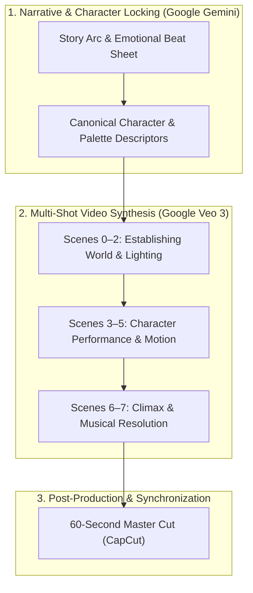

# 🌸 Sofia's Song: A Whimsical 1-Minute Story Made with Gemini & Veo 3


> **Author & Architect:** [Robina Mirbahar](https://github.com/RobinaMirbahar) (Google Developer Expert in Cloud & AI)  
> **Focus:** AI-Directed Cinematic Storytelling, Multi-Shot Prompt Choreography & Audio-Visual Synchronization with Google Veo 3  
> 🎥 **Watch the Short Film:** [Sofia's Song on YouTube](https://www.youtube.com/watch?v=rS-gXC0XoH0)

---

> *“One brave hum. Two magical friends. A village that listened.”*

**Sofia's Song** is a 1-minute Pixar-style animated short created with **Google Gemini prompt engineering** and **Google Veo 3 cinematic video generation**. Over eight cohesive scenes at a glowing lantern festival, timid protagonist *Sofia* overcomes her fear of judgment and discovers her voice—cheered on by her energetic squirrel sidekick *Squiggle* and gentle floating companion *Bloom*.

---

## 🎯 Engineering Purpose & Production Blueprint

### 1. 🎬 Directing Cohesive Multi-Shot Narratives with Google Veo 3
Generating a single 5-second AI clip is straightforward; directing a cohesive 60-second emotional narrative with consistent lighting, camera movement, and character identity requires structured prompt engineering. *Sofia's Song* documents an end-to-end Veo 3 multi-shot workflow.

### 2. 🎼 Gemini-Driven Storyboarding & Acoustic Choreography
Google Gemini structures shot-by-shot camera lenses, color palettes, character descriptors, and musical pacing cues so every cut feels intentional.

### 3. 📖 Reproducible Scene-by-Scene Prompts
Every scene breakdown, character-locking descriptor, and assembly step is shared in [`prompts/`](prompts/) so creators and educators can build their own animated shorts.

---

## 🏗️ Production Pipeline



---

## 🌟 Cast & Key Story Elements

| Element | Role & Visual Anchor |
| :--- | :--- |
| **🎤 Sofia** | Expressive protagonist with bright eyes, neatly braided black hair, and an embroidered golden-pink traditional festival outfit—timid at first, full of hidden courage. |
| **🐿️ Squiggle** | Loyal, energetic squirrel sidekick wearing a forest-green jumper and red scarf. |
| **🌸 Bloom** | Gentle floating blossom spirit in soft lavender petals and a daisy crown who brings calm encouragement. |
| **🍌 Pretend Mic & Lanterns** | A playful banana microphone, a gentle music box melody, and glowing paper lanterns that unite the festival crowd. |

---

## 📖 Scene Breakdown (60 Seconds)

| Scene | Prompt File | Title | Time | Narrative Beat |
| :---: | :--- | :--- | :---: | :--- |
| **0** | [`scene-0-intro.md`](prompts/scene-0-intro.md) | *What If They Judge Me?* | `0–8s` | Sofia hides behind a bush at the festival, hesitant to step out. |
| **1** | [`scene-1-distraction.md`](prompts/scene-1-distraction.md) | *They’re All Watching…* | `8–16s` | Squiggle grabs the playful banana mic, making the crowd laugh. |
| **2** | [`scene-2-slip.md`](prompts/scene-2-slip.md) | *Oops!* | `16–24s` | Sofia slips into swirling petals as the mic lands right beside her. |
| **3** | [`scene-3-first-note.md`](prompts/scene-3-first-note.md) | *Just One Word…* | `24–32s` | Bloom encourages honesty and heart over perfection. |
| **4** | [`scene-4-hi.md`](prompts/scene-4-hi.md) | *Hi.* | `32–40s` | Sofia finally speaks her first word into the mic. |
| **5** | [`scene-5-step-light.md`](prompts/scene-5-step-light.md) | *Did They Hear Me?* | `40–48s` | Sofia steps into the warm lantern light as petals swirl around her. |
| **6** | [`scene-6-ripple.md`](prompts/scene-6-ripple.md) | *She Sang.* | `48–56s` | Festival-goers begin to hum back—a ripple of shared music. |
| **7** | [`scene-7-chorus.md`](prompts/scene-7-chorus.md) | *Together Now* | `56–60s` | Everyone joins in for a glowing, harmonious finale. |

---

## 🔧 Tools & Official Resources

| Tool | Purpose | Official Documentation (GDE Tracked) |
| :--- | :--- | :--- |
| **[Google Gemini API](https://ai.google.dev/gemini-api/docs?utm_campaign=deveco_gdemembers&utm_source=deveco)** | Story arc scripting, character locking & shot prompt generation | [ai.google.dev/gemini-api/docs](https://ai.google.dev/gemini-api/docs?utm_campaign=deveco_gdemembers&utm_source=deveco) |
| **[Google AI Studio](https://aistudio.google.com/?utm_campaign=deveco_gdemembers&utm_source=deveco)** | Interactive prompt prototyping & scene refinement | [aistudio.google.com](https://aistudio.google.com/?utm_campaign=deveco_gdemembers&utm_source=deveco) |
| **[Google Veo 3 (DeepMind)](https://deepmind.google/models/veo/?utm_campaign=deveco_gdemembers&utm_source=deveco)** | Cinematic 3D-style video synthesis | [deepmind.google/models/veo](https://deepmind.google/models/veo/?utm_campaign=deveco_gdemembers&utm_source=deveco) |
| **[Google Cloud Vertex AI](https://cloud.google.com/vertex-ai/generative-ai/docs/models/veo/3-0-generate-preview?utm_campaign=deveco_gdemembers&utm_source=deveco)** | Enterprise Veo 3 video generation endpoint | [cloud.google.com/vertex-ai](https://cloud.google.com/vertex-ai/generative-ai/docs/models/veo/3-0-generate-preview?utm_campaign=deveco_gdemembers&utm_source=deveco) |
| **CapCut** | Final timeline assembly, trims, transitions & audio sync | — |

---

## 🎥 How to Reproduce

1. Open each scene prompt in [`prompts/`](prompts/) (`scene-0-intro.md` through `scene-7-chorus.md`).
2. Refine or adapt the visual storytelling cues in **Google Gemini**.
3. Render each 8-second shot using **Google Veo 3** on Vertex AI.
4. Assemble and synchronize the rendered clips in **CapCut** (or your preferred NLE).

---

## 🗂️ Repository Structure

```text
A-Gemini-Veo-3-Whimsical-Short/
├── README.md
├── LICENSE
└── prompts/
    ├── scene-0-intro.md
    ├── scene-1-distraction.md
    ├── scene-2-slip.md
    ├── scene-3-first-note.md
    ├── scene-4-hi.md
    ├── scene-5-step-light.md
    ├── scene-6-ripple.md
    └── scene-7-chorus.md
```

Each `.md` file contains a 3D-animation-ready scene specification with dialogue, camera cues, character-consistency anchors, and emotional tone.

---

## 💡 Inspiration

> *A single hum can start a chorus.*

*Sofia's Song* is a reminder that courage often starts small—and when one voice dares to rise, others follow. Created for whimsical storytelling fans, AI filmmakers, and educators.

**✨ Made with imagination. Powered by Google Gemini + Veo 3. ✨**

