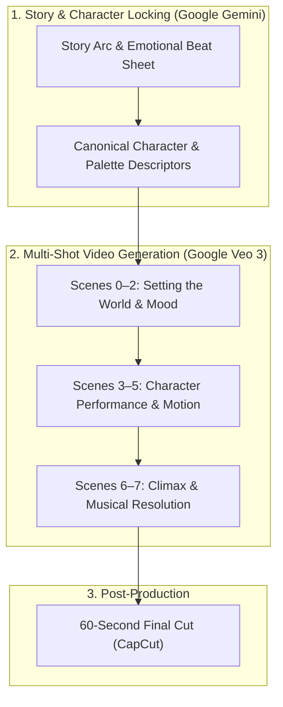

# 🌸 Sofia's Song — A Whimsical 1-Minute Short Made with Gemini & Veo 3


> “One brave hum. Two magical friends. A village that listened.”

**Sofia's Song** is a 1-minute, Pixar-style animated short about courage, friendship, and finding your voice. Sofia is afraid of being judged at a village festival. With a nudge from her friends Squiggle and Bloom, she hums one brave note, and soon the whole village is singing with her.

The story was scripted with **Google Gemini** and rendered with **Google Veo 3**. This repository shares the scene prompts and the workflow so you can make your own short.

🎥 **Watch the film:** [Sofia's Song on YouTube](https://www.youtube.com/watch?v=rS-gXC0XoH0)

---

## 🎯 Why I Built This

1. **🎬 Directing a multi-shot story with Veo 3.** Generating one 5-second clip is easy. Keeping lighting, camera movement, and characters consistent across a full minute takes real direction. This project documents my end-to-end Veo 3 workflow.
2. **🎼 Gemini as storyboard artist.** I used Gemini to plan each shot's camera lens, color palette, and musical pacing so every transition feels intentional.
3. **📖 A reproducible blueprint.** The scene breakdown, character-locking prompts, and assembly steps are all here so other creators can reuse them.

---

## 🏗️ Production Pipeline



---

## 🌟 Cast & Key Props

| | Who / What | Role |
| --- | --- | --- |
| 🎤 | **Sofia** | Shy at first, but full of hidden fire |
| 🐿️ | **Squiggle** | Hyper, scarf-wearing squirrel-like sidekick in a green jumper |
| 🌸 | **Bloom** | Gentle floating friend in lavender petals and a daisy crown |
| 🍌 | **Banana mic** | The pretend microphone that starts it all |
| 🎶 | **Music box & paper lanterns** | Set the festival mood |

Full visual descriptions for consistent character rendering are in each prompt file under [`prompts/`](prompts/).

---

## 📖 Scene Breakdown

| Scene | Prompt File | Title | Time | What Happens |
| :---: | --- | --- | --- | --- |
| 0 | [`scene-0-intro.md`](prompts/scene-0-intro.md) | What If They Judge Me? | 0–8s | Sofia hides behind a bush, afraid to step out. |
| 1 | [`scene-1-distraction.md`](prompts/scene-1-distraction.md) | They're All Watching… | 8–16s | Squiggle steals the banana mic; the crowd laughs. |
| 2 | [`scene-2-slip.md`](prompts/scene-2-slip.md) | Oops! | 16–24s | Sofia slips into petals; the mic lands beside her. |
| 3 | [`scene-3-first-note.md`](prompts/scene-3-first-note.md) | Just One Word… | 24–32s | Bloom encourages truth over perfection. |
| 4 | [`scene-4-hi.md`](prompts/scene-4-hi.md) | Hi. | 32–40s | Sofia finally speaks into the mic. |
| 5 | [`scene-5-step-light.md`](prompts/scene-5-step-light.md) | Did They Hear Me? | 40–48s | Sofia steps into the light as petals swirl. |
| 6 | [`scene-6-ripple.md`](prompts/scene-6-ripple.md) | She Sang. | 48–56s | Others hum back in a ripple of music. |
| 7 | [`scene-7-chorus.md`](prompts/scene-7-chorus.md) | Together Now | 56–60s | Everyone joins in a glowing, musical celebration. |

---

## 🔧 Tools Used

| Tool | Purpose |
| --- | --- |
| **Gemini** | Story scripting & scene prompt writing |
| **Veo 3** | Cinematic video generation |
| **CapCut** | Final edit, trims & transitions |

🔗 [Veo by Google DeepMind](https://deepmind.google/models/veo/?utm_campaign=deveco_gdemembers&utm_source=deveco)  
🔗 [Veo API Docs (Vertex AI)](https://cloud.google.com/vertex-ai/generative-ai/docs/models/veo/3-0-generate-preview?utm_campaign=deveco_gdemembers&utm_source=deveco)

---

## 🎥 How to Make Your Own

1. Open a scene prompt from the [`prompts/`](prompts/) folder.
2. Paste it into Gemini to refine the shot description.
3. Generate the clip with Veo 3 (via Vertex AI).
4. Repeat for all 8 scenes, then edit them together in CapCut or any video editor.
5. Share your 1-minute story with the world!

---

## 🗂️ Repository Structure

```text
A-Gemini-Veo-3-Whimsical-Short/
├── README.md
├── LICENSE
└── prompts/
    ├── scene-0-intro.md
    ├── scene-1-distraction.md
    ├── scene-2-slip.md
    ├── scene-3-first-note.md
    ├── scene-4-hi.md
    ├── scene-5-step-light.md
    ├── scene-6-ripple.md
    └── scene-7-chorus.md
```

Each prompt file is a 3D-animation-ready scene description with dialogue, camera cues, character-consistency notes, and emotional tone for Veo 3.

---

## 💡 Inspiration

> A single hum can start a chorus.

Courage often starts small, and when one voice dares to rise, others follow. Made for whimsical storytelling lovers, educators, and short-form animation fans.

**✨ Made with imagination. Powered by Gemini + Veo. ✨**

---

### 🚀 More Google Cloud & Agentic AI Projects by Robina Mirbahar

| Repository | Architecture & Focus | Live Status |
| :--- | :--- | :--- |
| **[gemma4-multilora-adk-eval](https://github.com/RobinaMirbahar/gemma4-multilora-adk-eval)** | Dynamic Multi-LoRA Hot-Swapping & CI/CD Agent Evaluation (`adk eval`) on Cloud Run GPUs with Gemma 4 & vLLM |   |
| **[slothsre-napops](https://github.com/RobinaMirbahar/slothsre-napops)** | SlothSRE ("NapOps") — Overnight Gemma 4 & Google ADK Incident Digest Agent with OpenTelemetry & Sentry AI Monitoring |   |
| **[streamforge-event-adk](https://github.com/RobinaMirbahar/streamforge-event-adk)** | Real-Time Event-Driven Multi-Agent Pipelines on Google Cloud with ADK (`ParallelAgent` & `LoopAgent`), Eventarc & Pub
